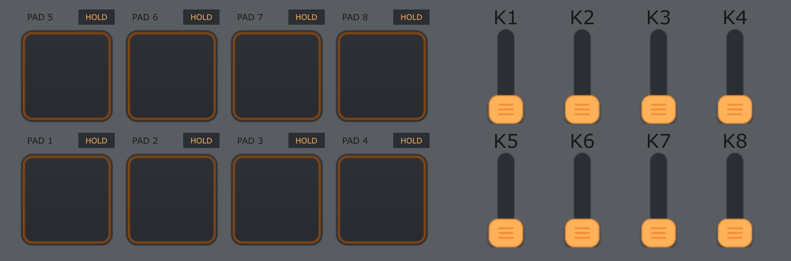

# VAL Pad & Knob Controller

A free control-surface component for TouchDesigner by [VAL](https://patreon.com/Valinsight).

 <!-- اگر اسکرین‌شات یا گیف دارید، می‌توانید آن را جایگزین کنید -->

---

## What Is It?
One `COMP` with 8 vertical sliders ("knobs") and 8 pads, laid out like a hardware MIDI controller. You can play it with the mouse, with a MIDI controller, or with both at the same time. Everything comes out as a single `CHOP`.

* **Good for:** Audio-reactive visuals, live performance, installations, or any project where you want quick controls without building a UI from scratch.

---

## Features
* **8 vertical sliders + 8 pads** in a hardware-style layout.
* **Single CHOP output** with a channel for every knob and pad.
* **Interactive pads** that light up when active.
* **Two pad modes (switchable per pad):**
  * `HOLD`: Value is 1 while the pad is held, 0 when released.
  * `ON/OFF`: Every press switches the pad between on and off.
* **MIDI channel selection** from a dropdown or custom text entry.
* **Per-knob range remap** (`From` range -> `To` range), similar to Math CHOP "Range".
* **Dynamic scaling:** Add (`+`) more knobs/pads or remove (`-`) unneeded ones.
* **Simultaneous input:** Mouse and MIDI work at the same time (last touch wins).

---

## Requirements
* TouchDesigner (tested and working on modern versions) or newer.
* *Optional:* Any MIDI controller (designed/tested with an AKAI LPD8 MK2).
* No external plugins or extra files needed.

---

## Installation
1. Drag the `.tox` file into your TouchDesigner network (or use `Palette > User > drop it in your own palette folder`).
2. The component is called `knobpad`. Click on it to see the panel, or open its viewer/press `o` over it to make it bigger.

---

## Quick Start
* **Mouse Only:** Drag sliders up and down, or click pads to toggle/hold. Use the small mode buttons next to pad names to change their behavior.
* **With MIDI:** 
  1. Create a `MIDI In CHOP` and connect your controller.
  2. Select the COMP, go to the **Setup** page, and drag your MIDI In CHOP into **MIDI Source**.
  3. Move/press controls on your hardware once so they register in the CHOP, then select them from the dropdowns on the **Knobs** or **Pads** pages.

---

## License
Free to use in personal and commercial projects, including client work and performances.  
**You may NOT re-sell this component or share it as your own.**  
Provided as is, without warranty. See the [LICENSE](LICENSE) file for details.

---

## Credits & Contact
Made by **VAL**  
* [Website](https://valstudio.art)  
* [Patreon](https://patreon.com/Valinsight)  
* [Instagram](https://Instagram.com/val.insight)  
* [YouTube](https://youtube.com/@Val.insight)
